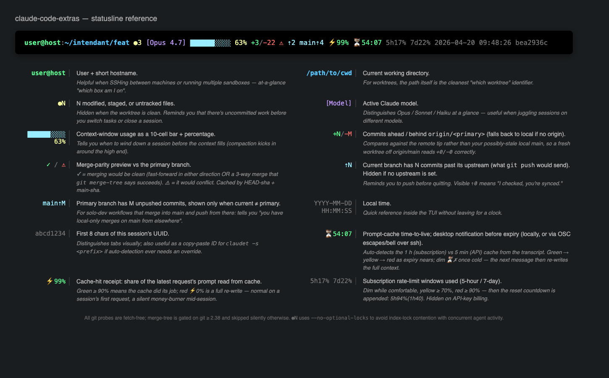

# claude-code-extras

Small tools that patch over a regression in [Claude Code](https://claude.com/claude-code):
thinking summaries were silently disabled by default, and the `showThinkingSummaries`
setting in `~/.claude/settings.json` is currently ignored.



This repo bundles:

- a **wrapper** that re-enables thinking summaries by passing the (undocumented)
  `--thinking-display summarized` flag on every invocation, self-adapting if the
  flag is ever renamed or removed;
- a **`claudet`** command that pulls thinking blocks out of the current
  session's JSONL log — because the TUI's Ctrl+O only shows the most recent
  one, and older summaries are overwritten as new ones stream in;
- a **statusline** that renders cwd, model, context-window usage with a
  progress bar, git ahead/behind vs. the primary branch, a **merge
  preview** (✓ clean / ⚠ would conflict) cached by commit SHA, a
  **cache-hit receipt** (⚡99%) for the latest request, a **prompt-cache
  TTL countdown** (⏳54:07) with a desktop notification before the cache
  goes cold, **subscription rate-limit gauges** (5h17% 7d22%), a clock,
  and the first 8 chars of the session id (install is opt-out via
  `--no-statusline`);
- an idempotent **`install.sh`** / **`uninstall.sh`** pair that's safe to
  run on a machine with an existing Claude Code setup.

Tested on Linux (bash) and macOS (zsh), with Claude Code v2.1.114.

## Quick start

```bash
git clone https://github.com/lovon-spec/claude-code-extras.git
cd claude-code-extras
./install.sh          # idempotent; safe to re-run
source ~/.bashrc      # or ~/.zshrc
hash -r               # clear bash/zsh's command path cache
claude --version      # should work as before — flag is passed transparently
claudet 5             # last 5 thinking blocks from your most recent session
```

## What gets installed

| File | What it is | When to remove |
|---|---|---|
| `~/.local/bin-wrap/claude` | bash wrapper that exec's the real claude with `--thinking-display summarized` | when Claude Code fixes `showThinkingSummaries`, or when it renames the flag (wrapper will warn you on stderr) |
| `~/.local/bin/claudet` | python3 script: extracts thinking blocks from the latest session JSONL | whenever the wrapper is removed |
| PATH block in your shell rc | prepends `~/.local/bin-wrap` and `~/.local/bin` | framed by sentinel markers so `uninstall.sh` can remove it cleanly |
| `~/.cache/claude-wrapper.flag` | per-version cache of the flag probe result | auto-regenerates; safe to delete anytime |
| `~/.claude/statusline-command.sh` *(unless `--no-statusline`)* | renders cwd, model, context-window bar, git +/- vs main, cache-TTL countdown, clock | remove with `./uninstall.sh`, or pass `--no-statusline` to skip on install |
| `statusLine` block in `~/.claude/settings.json` *(unless `--no-statusline`)* | points CC at the statusline script, 2-second refresh | `uninstall.sh` only removes it if the `command` value is the one we wrote — user-customized statusLines are left alone |

Nothing else under `~/.claude/` is touched.

## claudet usage

```bash
claudet              # last 10 thinking blocks from *this tab's* session
claudet N            # last N blocks
claudet 0            # all blocks in the session
claudet -f           # follow mode: stream new blocks as they arrive
claudet -s SPEC      # session selector: path, full UUID, or UUID prefix
claudet -h           # help
```

Follow mode is the intended workflow for Claude Code's Ctrl+O overwrite
behavior: leave `claudet -f` running in a side pane, and every summary
scrolls past in a durable, scrollable buffer.

### Session auto-detection (multi-tab safe)

The statusline script writes each live session's transcript path to
`~/.cache/claude-sessions/<claude-pid>` on every refresh. `claudet` walks
its own parent process tree, finds the nearest `claude` ancestor, and
looks up that pid's cache entry — so `!claudet` from any tab targets
*that tab's* session, regardless of which other tabs are active.

If auto-detection fails (not running inside claude, or a brand-new tab
whose statusline hasn't ticked yet), `claudet` lists the live sessions
it knows about and asks you to pick with `-s <prefix>`. It never
silently falls back to "most recent globally" — a wrong session is more
confusing than a clear failure.

The statusline also shows the first 8 chars of the session id at the end
of the line, so you can visually distinguish tabs and have a reference
for `-s` on the rare cold-start race.

## Cache-TTL countdown & expiry notification

Every Claude Code request keeps the conversation prefix alive in the API's
prompt cache — for 5 minutes on API-key billing, 1 hour on subscription
plans, refreshed on each use. While it's warm, your next message is cheaper
and starts faster; once it lapses, the next request re-writes the whole
context at full input cost. The statusline counts down the time the cache
has left (⏳54:07 — green, turning yellow and then red as expiry nears; a
dim ⏳✗ once cold) and fires a desktop notification shortly before expiry,
so a quick message can keep the cache warm.

Claude Code doesn't expose cache state, so the script infers it:

- **Freshness** comes from the timestamp of the transcript's most recent
  *usage-bearing* record — an actual API response — not from the file's
  mtime: Claude Code appends bookkeeping to idle transcripts (away-summary
  system records and the like) that would otherwise keep resetting the
  countdown while the real cache decays. (The countdown also runs during a
  single long tool call — correctly so: no API request is in flight then,
  and the cache really is decaying.)
- **TTL** is auto-detected from the most recent nonzero
  `ephemeral_{5m,1h}_input_tokens` cache-creation entry in the transcript
  tail, so it tracks whatever your plan / env vars actually negotiated
  (subscription plans get 1 h; `FORCE_PROMPT_CACHING_5M` etc. are picked
  up automatically because detection observes what really happened).
- The **notification** fires once per idle period (keyed by session id +
  transcript mtime under `~/.cache/claude-statusline-ttl/`), and only
  while there's still time to act — never after the fact. macOS uses
  `osascript` (the notification is attributed to Script Editor; allow it
  if macOS asks on first use), Linux uses `notify-send` if installed.
- **Over ssh** it works with zero extra setup: for remote sessions
  (`SSH_TTY`/`SSH_CONNECTION` set, or an `sshd` ancestor in the process
  tree — sudo chains commonly scrub the env) the script instead writes
  OSC 777 + OSC 9 escape sequences plus a terminal bell to the claude
  process's terminal device (found by walking the process tree — the
  statusline itself is spawned without a controlling tty). Those bytes
  ride the pty stream back to your **local** terminal emulator, and *it*
  raises the notification. kitty, WezTerm, Ghostty, foot and urxvt speak
  OSC 777; iTerm2 speaks OSC 9; Apple Terminal speaks neither but honors
  the **bell** — an audible beep plus a Dock badge. Terminals that speak
  both OSC dialects may notify twice — pin `osc777` or `osc9` via
  `CLAUDE_STATUSLINE_NOTIFY`. Inside tmux the escapes are
  passthrough-wrapped, which needs `set -g allow-passthrough on`
  (tmux ≥ 3.3).
- Ticking while idle relies on the `statusLine.refreshInterval` the
  installer writes (2 s); without it the statusline only re-runs on
  message events and the countdown would go stale between them.

Next to the countdown, **⚡99% is the receipt** that the cache actually
did its job: the share of the latest request's prompt that was *read*
from cache rather than re-written (`cache_creation`) or sent uncached.
Green ≥ 90 %, yellow ≥ 50 %, red below — ⚡0 % is a full re-write, which
is normal on a session's first request and a silent money-burner
mid-session. It comes from `context_window.current_usage` in the
statusline JSON, falling back to the transcript's last usage record on
older Claude Code versions. So after coming back to an idle session:
⏳ told you whether the cache *should* hit, and ⚡ tells you whether it
*did*.

The statusline also renders the **subscription rate-limit windows**
(`rate_limits` in the statusline JSON): `5h17% 7d22%` = 17 % of the
5-hour window and 22 % of the 7-day window used. Dim while comfortable,
yellow at ≥ 70 %, red at ≥ 90 % — and at red the reset countdown is
appended (`5h94%(1h40)`). Hidden on API-key billing, where the field
isn't provided.

| Env var | Effect |
|---|---|
| `CLAUDE_STATUSLINE_CACHE_TTL` | Cache TTL in seconds, overriding auto-detection; `0` hides both the ⚡ and ⏳ segments. |
| `CLAUDE_STATUSLINE_CACHE_WARN` | Warn threshold in seconds — at or below it the countdown turns yellow (red under half of it) and the notification fires; `0` disables the notification. Default 60, or 300 when the detected TTL is 1 h. |
| `CLAUDE_STATUSLINE_NOTIFY` | Delivery method(s), space-separable: `auto` (default), `osascript`, `notify-send`, `osc` (both escape dialects), `osc777`, `osc9`, `bell`, `off`. `auto` picks `osc bell` for remote sessions, otherwise the first available local mechanism. |
| `CLAUDE_STATUSLINE_RATE_LIMITS` | `0` hides the 5h/7d rate-limit gauges. |

## Installer behavior

- **Idempotent.** Re-running the installer on a machine that's already set
  up is a no-op: files are kept, the rc-file marker block is detected and
  skipped.
- **Non-destructive.** Existing `~/.local/bin-wrap/claude` or `~/.local/bin/claudet`
  files are preserved by default. Pass `--force` to overwrite (your previous
  content is saved to `<file>.bak-<timestamp>`).
- **Home-only.** Refuses to run as root; touches only files under `$HOME`.
- **Shell-aware.** Picks `~/.bashrc` (bash) or `~/.zshrc` (zsh) from `$SHELL`
  by default; override with `--rc FILE`.
- **Dry-run.** Pass `--dry-run` to see every action without executing any.

## Uninstall

```bash
./uninstall.sh        # removes files + marker block, leaves your own dotfiles alone
```

The rc file is backed up to `<file>.bak-<timestamp>` before the marker block
is removed. `~/.local/bin-wrap/` is removed only if it's empty.

## Requirements

- bash (any version ≥ 3.2 — macOS stock bash is fine)
- python3 (for `claudet`)
- `readlink -f` (present on Linux, and on macOS 12.3+)
- jq (used by the statusline; pre-installed on macOS, `apt install jq` on Debian/Ubuntu)
- desktop notifications for the cache-TTL warning use `osascript` (built
  into macOS) or `notify-send` (Linux; `apt install libnotify-bin`); over
  ssh they use OSC escape sequences plus the terminal bell instead.
  Banners need a supporting *local* terminal (kitty / WezTerm / Ghostty /
  foot / urxvt / iTerm2); Apple Terminal only beeps and badges the Dock.
  If nothing suitable is present, the countdown still renders and only
  the notification is skipped.
- **git ≥ 2.38** for the statusline's merge-preview indicator (`⚠` / `✓`).
  Older git silently skips the feature and shows just `+N/-M`. Debian 12
  and macOS Ventura (13) and later ship a new-enough git; Debian 11 does
  not. Everything else works on any git.
- Claude Code installed via the native installer (the wrapper's fallback
  logic expects `~/.local/share/claude/versions/<ver>`). Homebrew / npm
  installs will work through PATH-based lookup but haven't been tested.

## Why the wrapper self-adapts

The `--thinking-display summarized` flag is undocumented — it doesn't show
up in `claude --help`. If Anthropic renames or removes it, a plain alias
would cause `claude` to fail on every invocation with "unknown option". The
wrapper instead probes the flag once per installed version (caching the
verdict in `~/.cache/claude-wrapper.flag`) and silently drops the flag if
it's no longer accepted, so the wrapper never bricks your `claude` command.
On version upgrade, it re-probes and warns on stderr if the flag stops
working — that's the signal to uninstall.

## Why the wrapper lives in a dedicated dir

`~/.local/bin/claude` is a symlink Claude Code maintains itself: deleting
or overwriting it triggers self-repair from a running claude process or
the installer, wiping out anything placed there. The wrapper therefore
lives in `~/.local/bin-wrap/`, a directory Claude Code doesn't touch,
placed earlier in PATH.

## Limitations and known gotchas

- The wrapper needs `~/.local/bin/claude` (or another `claude` on PATH,
  or `~/.local/share/claude/versions/`) to find the real binary. On a
  fully fresh machine without Claude Code yet, the wrapper will install
  successfully and only start working after Claude Code is installed.
- `claudet -f` does not follow session switches — if you exit one Claude
  Code session and start another, Ctrl+C and re-run `claudet -f` to pick
  up the new session file.
- `readlink -f` is unavailable on macOS earlier than 12.3. Use Ventura or
  newer, or replace `readlink -f` in the wrapper with a python shim.
